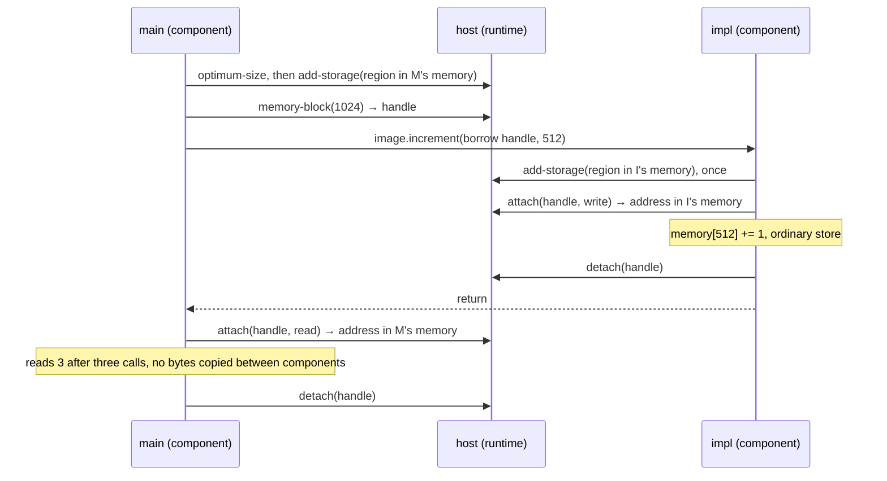

# Zero-copy shared memory for Wasm components

The [component model](https://component-model.bytecodealliance.org/) is
*shared-nothing*: every component owns its linear memory, and every `list` or
`string` that crosses a component boundary is copied into the receiver's memory.
For small values that is cheap. For camera frames, audio buffers, tensors or
network packets passed along a pipeline of components, each hop costs a copy
and an allocation.

This repository is a working proof of concept for a different approach.
**Shared memory blocks** are resources owned by the host. Components pass
*handles* to them across boundaries instead of bytes. A component that wants to
read or write the contents *attaches* the block, and the host maps it into the
component's linear memory. The component works on it with ordinary loads and
stores, then *detaches* it again.

The sandbox stays intact:

- a block is only visible while it is attached
- writers attach exclusively, readers share
- the guest never chooses the address: it donates a region of its own memory
  and the host decides where inside it to map the block

A host without an MMU or `mmap` can emulate the same API by copying at attach
and detach time. Guests behave the same either way.

Only the host can implement this, because it needs access to each guest's
linear memory. The interface is still written in WIT
([`wit/shm.wit`](wit/shm.wit)), so existing tooling and bindings generators
work unchanged.

For the reasoning behind the design, and how it could become part of the
canonical ABI, see [DESIGN.md](DESIGN.md).

## How it works

The minimal example passes one block to another component three times, and
each time the other component increments a byte in it:



The interface in short (`test:shm/exchange`, see the comments in
[`wit/shm.wit`](wit/shm.wit) for the full semantics):

| function | purpose |
| -------- | ------- |
| `constructor(size)` | create a block, owned by the host |
| `minimum-size()` | how much storage attaching this block needs (adds page alignment padding) |
| `optimum-size(count, size)` | storage for `count` simultaneous attachments, independent of a block |
| `add-storage(area)` | donate a region of the caller's linear memory for future attachments |
| `attach(options)` | map the block into that region: `write` is exclusive, otherwise shared read |
| `detach(consumed)` | unmap; the byte count transfers ownership of the contents (see DESIGN.md) |
| `clone()` | another handle to the same block, for broadcasting read-only data |
| `create-partition(...)` | hand out sub-regions, so a guest component can act as an allocator (not implemented yet) |
| `create-local(area)` | wrap local memory as a block (native build only, likely superseded by `create-partition`) |

On Linux, the bundled runtime backs every block with an unlinked temporary
file. `attach` calls `mmap(MAP_FIXED | MAP_SHARED)` on that file, at the
first page boundary inside the donated region, which is why storage needs up
to two extra pages. Two components attached to the same block share the same
physical pages.

## What's in this repository

The examples build on each other:

| | example | shows |
| - | ------- | ----- |
| 1 | [`examples/minimal`](examples/minimal) | the bare primitives: one block, two components, the sequence above |
| 2 | [`pub-sub`](pub-sub) | a publisher/subscriber component built *on top of* the primitives: blocks travel over `stream<memory-block>` to several subscribers (zero copy fan-out) |
| 3 | [`examples/complex`](examples/complex) | structured data: a `list<string>` built mostly in place with [flat data types](https://github.com/cpetig/flat-types-rust), read by two subscribers without any copy after construction |

Example 2 makes the point that the host only provides the mechanism. The
policy (pooling buffers, fanning out to subscribers) lives in an ordinary,
composable guest component.

Supporting pieces:

| directory | contents |
| --------- | -------- |
| [`wit/`](wit) | `shm.wit`: the `exchange` and `pub-sub` interfaces and the worlds of the examples |
| [`runtime/`](runtime) | wasmtime-based host: implements `exchange` with `mmap` and runs a composed component |
| [`pub-sub/rust-client/`](pub-sub/rust-client) | crate `wasm-shm`: Rust bindings for using `exchange` and `pub-sub` |
| [`pub-sub/wasi-clocks/`](pub-sub/wasi-clocks) | Rust bindings for importing `wasi:clocks` 0.3 |
| `wit-bindgen/` | submodule: fork of wit-bindgen (WASI 0.3 support, plus the native build option) |
| `flat-types-rust/` | submodule: the flat data types used by example 3 |

## Related work

This prototype explores one point in a larger design space. Proposals in the
component model that address the same copying cost:

| proposal | idea | relation to this repository |
| -------- | ---- | --------------------------- |
| [Lazy value lowering (#383)](https://github.com/WebAssembly/component-model/issues/383) | instead of `cabi_realloc`, the receiver gets a handle to a pending value and copies it with `canon value.lower` to wherever it wants | removes the allocation and lets the receiver choose the destination, but still copies once per hop; shared memory blocks remove the copy too |
| [Caller-provided buffers (#369)](https://github.com/WebAssembly/component-model/issues/369) | the caller supplies the storage for a result (`readable-buffer`/`writable-buffer` built-ins) | the same "caller owns the storage" idea that `add-storage` uses; an output memory block passed as an argument is a caller-provided buffer that the callee can also keep or forward |
| [Flat data representation (#398)](https://github.com/WebAssembly/component-model/issues/398) | relative-pointer, position-independent encodings of lists and strings | makes structured data meaningful at any mapping address; example 3 is the prototype |
| [Memory mapping in the CM (#568)](https://github.com/WebAssembly/component-model/issues/568) | expose core wasm `memory.map` as a mappable WIT type | the discussion links this repo's [DESIGN.md](DESIGN.md); `attach`/`detach` would become built-ins on top of it |
| [memory-control](https://github.com/WebAssembly/memory-control) | core wasm proposal for mapping and protecting regions of linear memory | what a non-hack runtime implementation would use instead of `mmap` behind the engine's back |
| [Symmetric ABI (#386)](https://github.com/WebAssembly/component-model/issues/386) | a calling convention to link components natively | the optional native build of this repository (see below) |

According to the component model
[Explainer](https://github.com/WebAssembly/component-model/blob/main/design/mvp/Explainer.md),
`realloc` is expected to be replaced by "a combination of caller-supplied
buffers and lazy value copying". Shared memory blocks would complement that
for large payloads, where even one copy is too many.

## Building and running

Prerequisites: a nightly Rust toolchain with the `wasm32-wasip2` target,
[`wasm-tools`](https://github.com/bytecodealliance/wasm-tools), and the
submodules (`git submodule update --init --recursive`).

```sh
make run-minimal     # prints "... = 3"
make run-pub-sub     # two subscribers receive values, one per second
make run-complex     # two subscribers print "hello one" ... "hello ten"
```

`make` builds everything. Each step on its own:

- runtime: `cd runtime && cargo build`; run a component with
  `runtime/target/debug/runtime <component.wasm>`
- minimal example: `cd examples && cargo build --target wasm32-wasip2 -p main -p implementation`,
  then compose `main.wasm` with `implementation.wasm` (see `Makefile`)
- pub-sub: `pub-sub/build-wasm.sh` builds and composes `pub-sub/target/wasm32-wasip2/debug/combined.wasm`
- complex example: `examples/complex/build-wasm.sh` (also builds the pub-sub component)

Components that wait on streams can't block inside the synchronous
`wasi:cli/run` 0.2 that Rust's `main` becomes. The pub-sub subscriber and the
complex starter therefore export the asynchronous WASI 0.3 `wasi:cli/run`
instead (`no_main` plus `generate!`), and the runtime prefers that export.

## Native build option (symmetric ABI)

All crates can also be built as native shared libraries that call each other
directly, using the [symmetric ABI](https://github.com/WebAssembly/component-model/issues/386)
of the wit-bindgen fork (see `wit-bindgen/crates/cpp/DESIGN.md`) instead of
the component model. The same source code compiles for both. In this mode
`pub-sub` also implements `test:shm/exchange` (in-process, no `mmap`), and
`pub-sub/wasi-clocks/native` provides `wasi:clocks`. No wasm runtime is
involved.

The features `canonical` (default) and `symmetric` are mutually exclusive:

```sh
cd pub-sub && cargo run -p subscriber --no-default-features -F symmetric
cd examples && cargo run -p starter --no-default-features -F symmetric
```

or `make native` / `make run-native`. Use `cargo run`: it sets the library path
for the shared libraries, while running a binary directly needs
`LD_LIBRARY_PATH`.

## Status and limitations

This is a proof of concept. **Don't use the runtime in production.**

- The wasm runtime doesn't enforce the rules. Exclusive write attachment is
  unchecked, `attach` always reports the full block size, and the
  `consumed` count of `detach` is ignored. It also relies on wasmtime internals
  to find a guest's linear memory. The in-process implementation of the
  native build does track these (`busy`, valid and consumed bytes), so it is
  the better reference for the intended semantics.
- Mapping replaces the pages of the donated region. Whatever the guest stored
  there before is hidden while a block is attached, which is why storage must
  be dedicated to attachments.
- `create-partition` isn't implemented anywhere yet, and `create-local` only
  in the native build.
- `publish` doesn't wait for slow subscribers: a write that can't complete
  immediately is dropped. Blocking attachments are a planned extension.
- The checked-in bindings under `pub-sub/rust-client/src` and
  `pub-sub/wasi-clocks/src` only ease debugging; `generate!` works equally
  well. Regenerate them with the `generate.sh` scripts.
